# Strongest Update for Fault Diagnosis! Classification Model Based on VMD+Transformer-BiGRU

Preface
This article is based on the bearing data from Case Western Reserve University (CWRU), which first undergoes data preprocessing to create and load the dataset, and finally implements the VMD-Transformer-BiGRU model to classify faulty data through PyTorch. For a detailed introduction to the CWRU bearing data, please refer to the following:  
Python-Case Western Reserve University (CWRU) Bearing Data Interpretation and Classification Processing

1 Model Introduction and Innovations
1.1 Model Introduction
●Dataset: CWRU Case Western Reserve University Bearing Dataset
●Environmental Framework: Python 3.9, PyTorch 1.8 or above are required for running
●Accuracy: Test set achieves 99% accuracy
●Usage Objectives: Paper requirements, graduation design requirements
●Code Guarantees: Code with detailed comments can be run successfully upon implementation.
1.2 Innovations Introduction
Innovative Bearing Fault Diagnosis Model Based on VMD-Transformer-BiGRU:
1. Innovative Points:
 (1)Utilizing VMD to decompose the raw signal into multiple modal components, extracting both frequency domain and time domain features of the signal, enhancing its separability, providing clearer signal input for subsequent feature extraction and classification;
 (2)Transformer is a deep learning model based on attention mechanisms that can effectively capture the correlation and global context information between different signal modalities. In the task of bearing fault diagnosis, Transformer helps the model capture the complex correlations between different time steps in the bearing vibration signals.
(3) BiGRU is an improved RNN structure capable of processing sequential data in both forward and backward directions, compared to traditional LSTMs, it has fewer parameters and higher computational efficiency. BiGRU can further process features extracted through Transformers, capturing bidirectional dynamic information in time series, enhancing the ability to identify temporal characteristics of fault patterns.
2. Principle and Process:
Firstly, use VMD to decompose the original bearing signal into multiple modal components; each modal component serves as input for feature extraction and abstraction through a Transformer; the features extracted by the Transformer are then processed by BiGRU for time series modeling and feature fusion; finally, the fused features are utilized for bearing fault diagnosis and classification. By integrating these two models, the innovative model can achieve better performance and results in bearing fault diagnosis tasks, enhancing the accuracy and efficiency of fault diagnosis.
2. Bearing Data Loading and Preprocessing
2.1 Import Data
Refer to the previous article for preprocessing of fault classification 10, and the Case Western Reserve University bearing data set: Classification 10 dataset.
\ttrain_set, val_set, test_set are all divided into training set, validation set and test set according to the ratio of 7:2:1, and finally save the data.
The above figure is the form of data reading and preprocessing ideas.
2.2 Failure VMD Decomposition and Visualization
Step 1: Mode selection
Observe the center frequency under different K values, select the K value; Starting from K=4, there are modes with similar center frequencies, indicating overdecomposition. Therefore, the number of modes K is set to 4.
\t  
Step 2: Visualization of Decomposition and Breakdown of Faulted VMD
\t  
\t2.3 Preprocessing of VMD Decomposition for Fault Data
\t  
3. Innovation Diagnosis Model Based on Pytorch's VMD+Transformer-BiGRU
\t3.1 Define the Transformer-BiGRU classification network model
3.2 Set parameters and train the model
100 epochs, accuracy 100%, the VMD-Transformer-BiGRU network has a significant effect in classification. The Transformer-BiGRU model can fully extract multi-scale features of bearing fault signals, with fast convergence speed and outstanding performance, which is particularly evident.
3.3 Model Evaluation
(1) Accuracy, Precision, Recall, F1 Score
(2) Fault classification confusion matrix:
\t  
(3) Classification Label Visualization
\t\t  
(4) Original Data t-SNE Feature Visualization
\t\t  
(5) t-SNE feature visualization after model training:
\t\t  
Click to download: Complete original data, Python code
Previously Featured Content:
Python-Case Western Reserve University (CWRU) Bearing Data Interpretation and Classification Process
Python Bearing Fault Diagnosis (I) Short-Time Fourier Transform STFT
Python Bearing Fault Diagnosis (II) Continuous Wavelet Transform CWT
Python Bearing Fault Diagnosis (III) Empirical Mode Decomposition EMD
Pytorch-LSTM bearing fault one-dimensional signal classification (I)
Pytorch-CNN bearing fault one-dimensional signal classification (II)
Pytorch-Transformer bearing fault one-dimensional signal classification (III)
Python Bearing Fault Diagnosis (IV) Failure Classification Based on EMD-CNN
Python Bearing Fault Diagnosis (5) Fault Classification Based on EMD-LSTM
Python bearing fault diagnosis (6) Feature-based fault classification based on EMD-Transformer
Python bearing fault diagnosis (7) Fault classification based on EMD-CNN-LSTM
Python bearing fault diagnosis (8) Parallel model of EMD-CNN-GRU for fault classification
Bearing fault identification model based on FFT + CNN - BiGRU-Attention, attention to time and frequency features
Bearing fault identification model based on FFT + CNN - Transformer, attention to time and frequency features
Python bearing fault diagnosis (9) Fault classification based on VMD+CNN-BiLSTM
Python bearing fault diagnosis (10) Fault classification based on VMD+CNN-Transformer
Python bearing fault diagnosis (11) Fault classification based on VMD+CNN-BiGRU-Attention
Cross-attention fused time and frequency features in FFT + CNN - BiLSTM-CrossAttention bearing fault identification model
Cross-attention fused time and frequency features in FFT + CNN-Transformer-CrossAttention bearing fault identification model
Python bearing fault diagnosis tutorial
Python bearing fault diagnosis (13) Super strong machine learning recognition model based on fault signal feature extraction
Python bearing fault diagnosis (14) Highly innovative fault recognition model
Python bearing fault diagnosis (15) One-dimensional fault signal recognition model based on CNN-Transformer
Python bearing fault diagnosis (16) Highly innovative fault recognition model (II)
Python Bearing Fault Diagnosis (18) - Innovative Diagnosis Model Based on CNN-TCN-Attention  
High-Innovation Bearing Fault Diagnosis Model Based on GADF+Swin-CNN-GAM  
Attention Magic Modification | Superior Bearing Fault Diagnosis Model!  
END  
\t2. Friends who like this can click to follow, give the article a "like", share it in WeChat groups or discuss in groups.

## Images

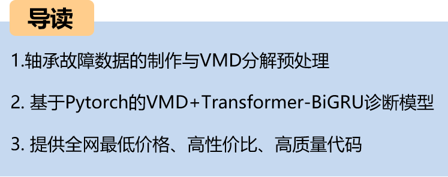
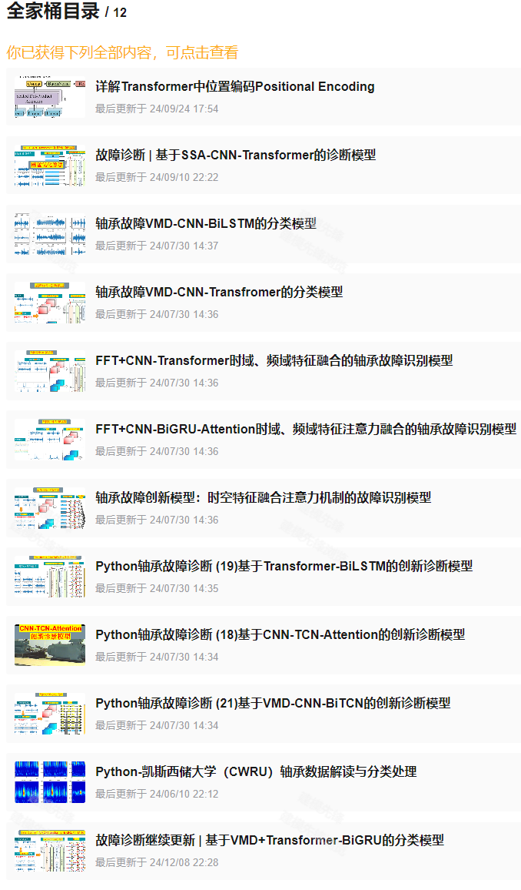
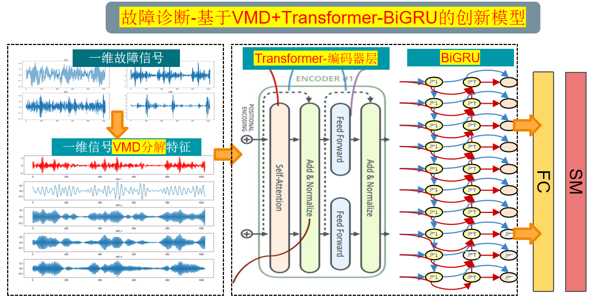

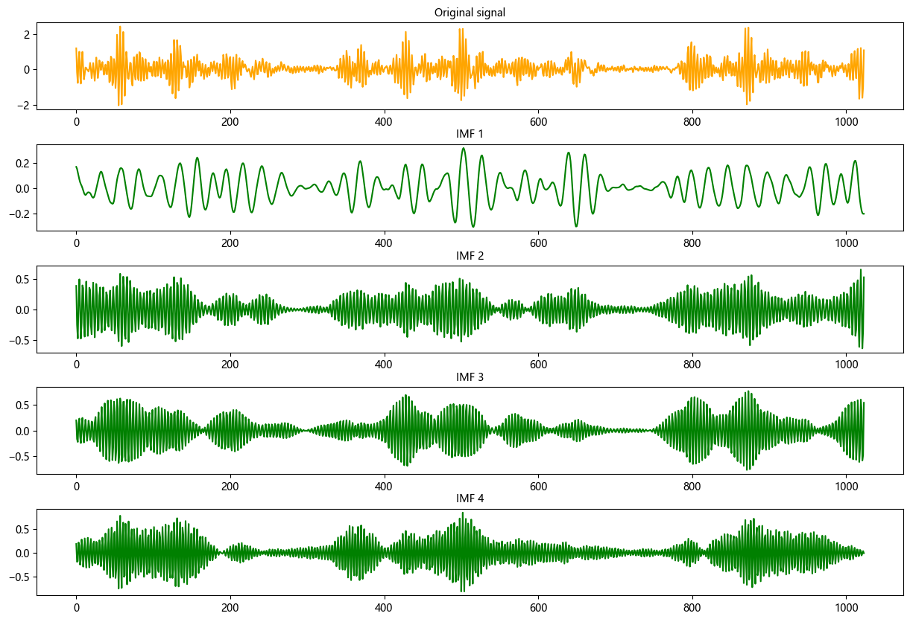
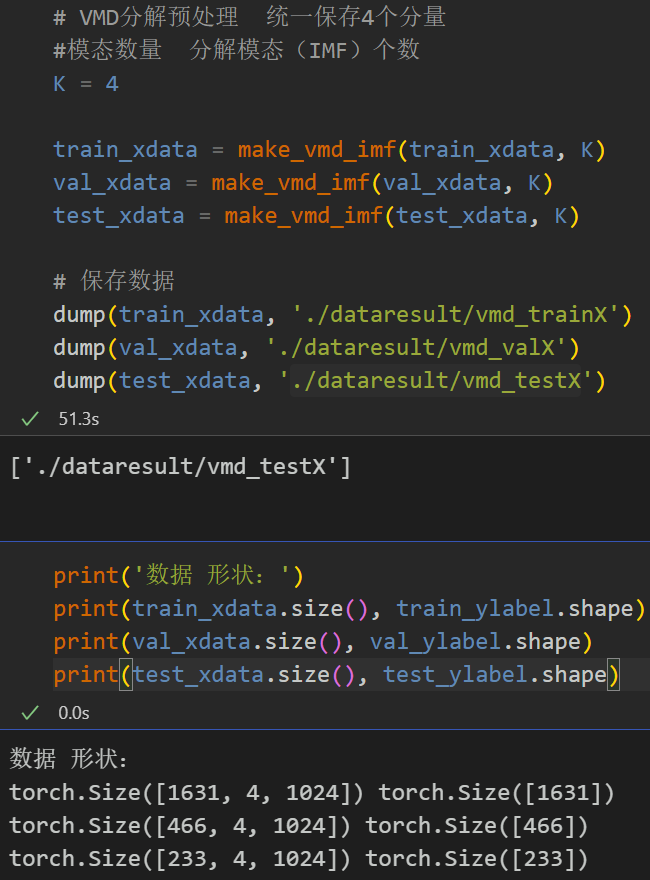
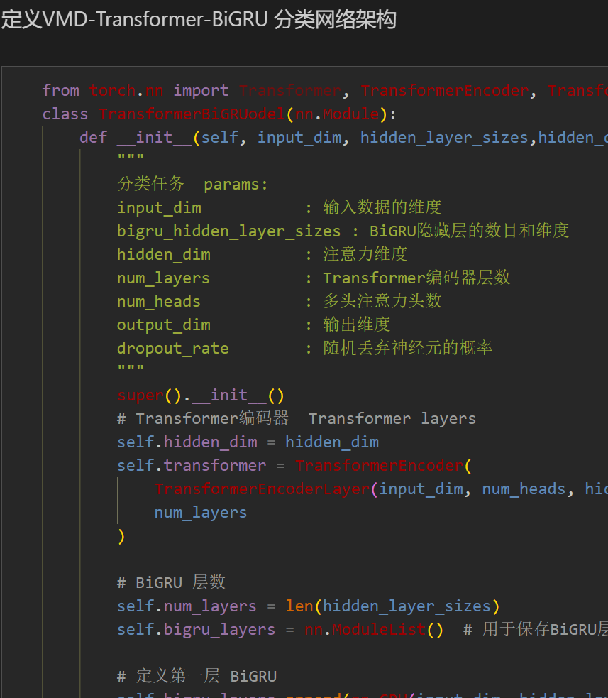
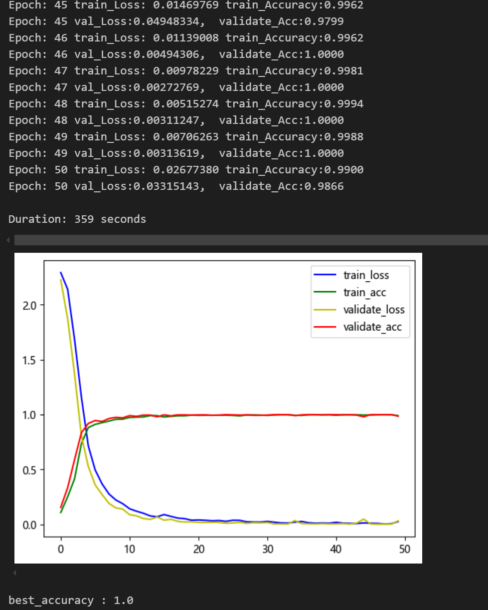
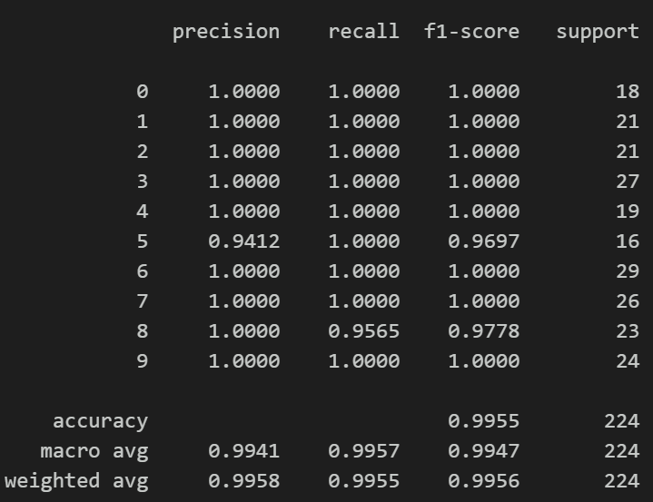
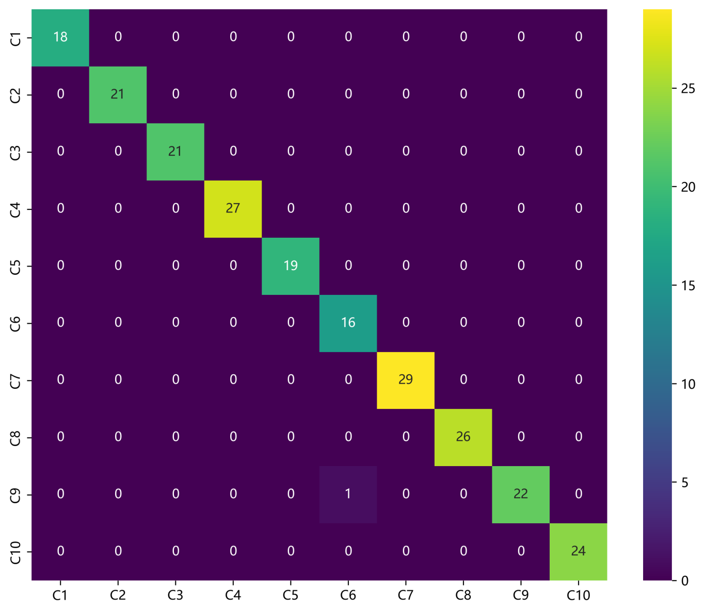
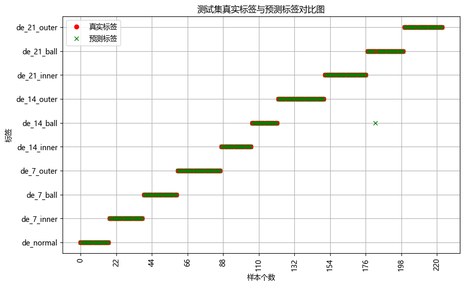
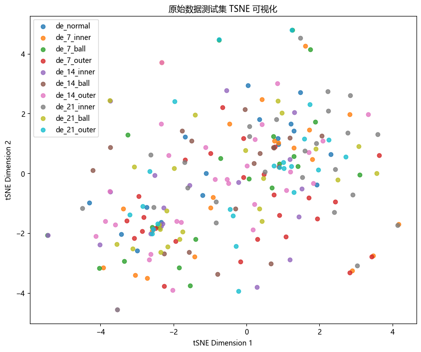
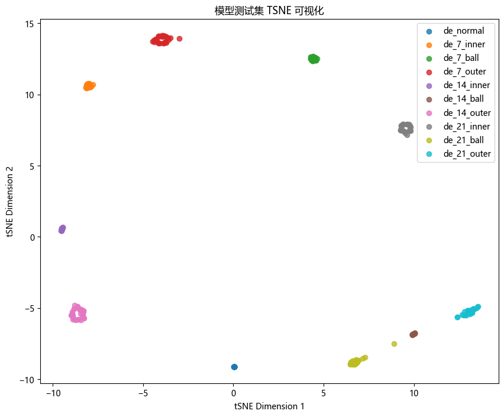
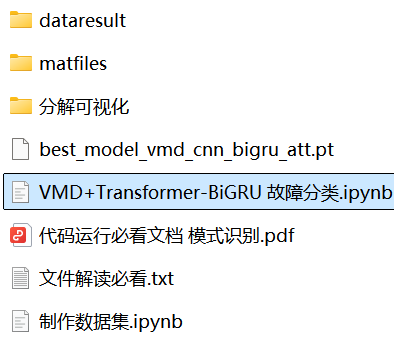

<!-- PAYMENT_BLOCK -->

## Get this dataset

- Payment link (Stripe): [Buy now](https://buy.stripe.com/3cs8yP7sY87d0vu9AB)
- Payment QR code: 

<!-- /PAYMENT_BLOCK -->
